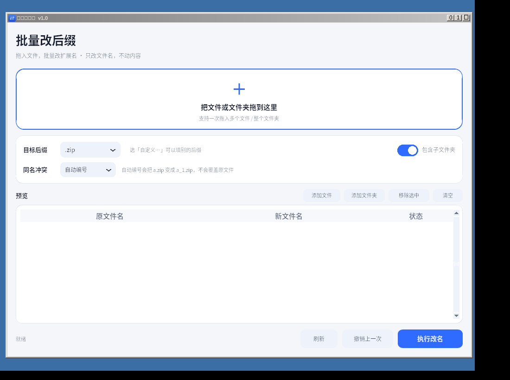

# ext-rename · 批量改后缀

把文件 / 文件夹拖进窗口，批量把扩展名改成 `.zip`、`.7z`、`.mp4` 等任意后缀。

> **本项目由 AI 生成**
>
> 代码、界面设计、图标与文档均由 AI（豆包）生成，人工只负责提出需求与验收修改。
> 因此请把它当作一个可用的工具来用，而不是教科书式的开源范例；如发现问题欢迎开 Issue。

## 特性

- **拖拽即用**：文件、文件夹直接拖进窗口，重复路径自动去重
- **预设 + 自定义**：内置 `.zip` `.7z` `.rar` `.mp4` `.mp3` `.jpg` `.png` `.pdf` `.txt`，需要别的后缀选「自定义…」直接输入（带不带点都行）
- **先预览后执行**：表格列出「原文件名 → 新文件名 → 状态」，确认无误再动手
- **不覆盖原文件**：同名冲突自动编号（`a.zip` → `a_1.zip`），也可选择跳过
- **可撤销**：每次执行在 exe 同目录写 `撤销记录.json`，一键整批还原
- **浅色现代化界面**：圆角卡片、柔和浅蓝按钮、自绘胶囊开关（CustomTkinter）
- **绿色免安装**：单文件 exe，不写注册表，只在程序目录留 `撤销记录.json`

## 截图



## 使用方法

1. 下载 `批量改后缀.exe`，双击运行（Windows 10 / 11 64 位，无需安装 Python）
2. 拖入文件或文件夹
3. 选目标后缀（下拉预设或「自定义…」手输）
4. 看预览，点「执行改名」

「包含子文件夹」开关：拖入的是文件夹时，决定要不要递归处理子目录里的文件；直接拖单个文件时该开关不生效。

## 从源码运行

```bash
pip install customtkinter==5.2.2 tkinterdnd2
python ExtRename.py
```

## 打包

```bash
pip install pyinstaller
pyinstaller --noconfirm --onefile --windowed --name ExtRename --icon app.ico \
    --add-data "app.ico;." --collect-all customtkinter --collect-all tkinterdnd2 ExtRename.py
```

Windows 下产物在 `dist/ExtRename.exe`，约 15 MB。

## 目录结构

```
ExtRename.py      主程序（界面 + 改名逻辑）
app.ico           程序图标
使用说明.md        面向使用者的说明文档
preview.png       界面截图
批量改后缀.exe      已打包的单文件程序
```

## 注意

- 本工具**只改文件名后缀，不转换文件内容**。把 `xx.txt` 改成 `xx.mp4` 不会让它变成视频。
- 撤销记录 `撤销记录.json` 与 exe 放在同一目录，删掉就无法撤销上一次操作。

## 声明

本项目内容由 AI 生成，按「现状」提供，不附带任何明示或暗示的担保；使用前请先在备份副本上试跑。
